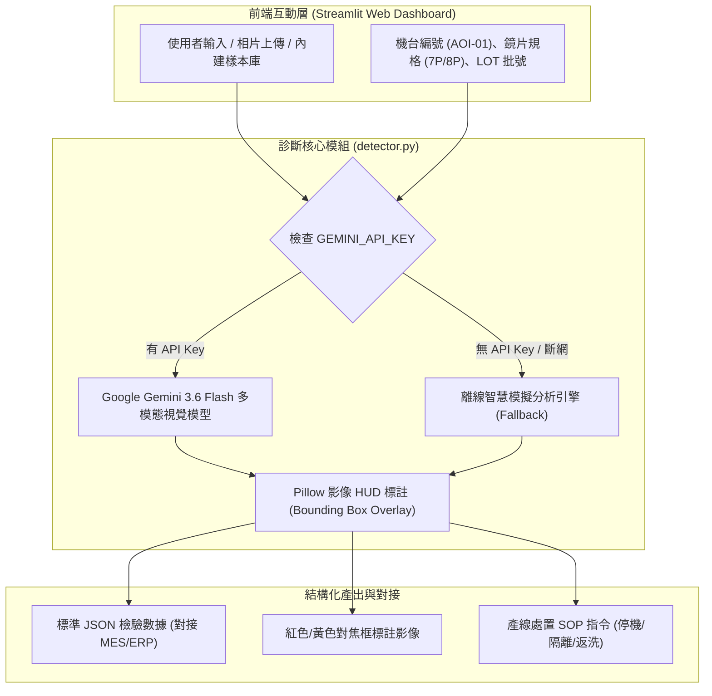

# 🔬 光學鏡片瑕疵多模態分析與診斷助手 (Optical Defect Multimodal Diagnostic Assistant)
## 完整技術架構文件與面試作品集手冊 (Portfolio Documentation)

---

## 📌 1. 專案概述 (Executive Summary)

* **專案名稱**：光學鏡片瑕疵多模態分析與診斷助手 (Optical Defect AI POC)
* **核心定位**：專為光學鏡片製造業（手機鏡頭、AR/VR Pancake 摺疊光路鏡片、車載 LiDAR）打造的 **多模態視覺檢驗與智慧處置系統**。
* **解決痛點**：
  1. **傳統 AOI 盲點**：傳統光學檢測僅能透過固定閥值比對，對複雜刮痕、微氣泡與有機油污易產生誤判。
  2. **缺乏即時處置引導**：傳統檢驗僅回傳 Pass/Fail，產線作業員與設備工程師仍需查閱紙本手冊判斷停機或返工。
  3. **本系統創新**：結合 **Google Gemini 多模態視覺技術 (Multimodal Vision)**，兼具「**瑕疵精準分類**」、「**2D 影像座標鎖定 (Bounding Box)**」與「**生成式 SOP 標準作業流程**」，實現產線秒級智慧診斷。

---

## 🛠️ 2. 核心技術棧 (Technology Stack)

| 領域 / 元件 | 使用技術與工具 | 核心用途與亮點 |
| :--- | :--- | :--- |
| **多模態視覺大模型** | **Google Gemini 3.6 / Flash** (`google-genai` SDK) | 接收高解析光學照片，進行特徵辨識、缺陷評級與根因推論 |
| **視覺目標檢測與標註** | **2D Bounding Box 座標輸出** + **Pillow (PIL)** | 模型直接輸出 `[ymin, xmin, ymax, xmax]` 空間座標，程式動態繪製工控 HUD 鎖定框 |
| **結構化數據控制** | **Structured Output (JSON Schema)** | 強制大模型輸出標準 JSON，確保無縫對接 MES (製造執行系統) 與 ERP |
| **Web 儀表板與互動** | **Python Streamlit** | 現代化工控深色/淺色自適應儀表板、鏡頭即時拍照與拖曳上傳 |
| **雲端部署與安全架構** | **Streamlit Community Cloud** + **Git/GitHub** | 自動化 CI/CD 一鍵上線、使用 **Secrets** 管理 API 金鑰確保安全 |
| **容錯與展示架構** | **雙模式容錯引擎 (Live API + Mock Engine)** | 具備離線特徵分析與預設樣本庫，在斷網或無金鑰環境下保證 100% 流暢演示 |
| **語義檢索技術 (RAG 模組)** | **BAAI/bge-small-zh-v1.5** + **Qwen2.5-0.5B-Instruct** | 知識庫向量化與內部檢驗規章問答檢索能力 |

---

## 🏗️ 3. 系統架構與資料流 (System Architecture)

---

## 🎯 4. 專案五大技術亮點 (Key Highlights)

### 1. 多模態視覺即時分析 (Vision Multimodal Understanding)
- 透過影像與 Prompt 的多模態交織推理，克服傳統演算法難以辨識「半透明有機油污光暈」與「微氣泡折射」的難題。

### 2. 空間幾何標註與 HUD 對焦框 (Spatial Grounding & Bounding Box)
- 利用大模型的物件偵測能力輸出 `0~1000` 正規化座標，並在 Python 後端透過 Alpha 混合渲染出工控級四角鎖定框與警示遮罩。

### 3. 嚴格結構化輸出 (Structured JSON Reliability)
- 設計工業標準 JSON Schema，回傳包含 `has_defect`、`severity_level (0-5)`、`affected_area_percentage` 等數值化指標，避免 LLM 出現無法解析的自由格式。

### 4. 自動生成情境式 SOP (Context-Aware Actionable Guidance)
- 模型依據不同的機台類型（研磨線、射出成型線、鍍膜線）與鏡片型號，自動產出對應的排障步驟（如調整成型保壓、檢查真空吸嘴、超音波二次精洗）。

### 5. 雲端部署與金鑰安全管理 (Production-Ready Cloud Architecture)
- 原始碼託管於 GitHub，部署至 Streamlit Cloud，透過雲端環境變數與 Secrets 隔絕敏感金鑰，符合資安規範。

---

## 💼 5. 履歷專案描述範本 (可直接複製使用)

### 📄 專案名稱：光學鏡片瑕疵多模態視覺診斷與智慧處置系統 (POC)
- **技術棧**：`Python`, `Google Gemini 3.6 Flash`, `Multimodal Vision`, `Streamlit`, `Pillow`, `Git`, `RESTful API`
- **專案成果**：
  - 開發一套基於 **Gemini 視覺多模態大模型** 的智慧光學鏡片 AOI 診斷系統，支援表面刮痕、氣泡、油污、崩角等 5 類缺陷即時識別。
  - 設計 **Spatial Bounding Box 演算法**，在 Web 端即時渲染 HUD 工控鎖定標註圖，提供精確瑕疵座標定位。
  - 導入 **嚴格結構化 JSON 控制** 與 **動態 SOP 生成模組**，將檢驗結果與機台處置建議（停機/返修/放行）秒級串聯，降低產線決策時間。
  - 完成 **Streamlit Community Cloud 雲端 CI/CD 部署**，具備金鑰安全隔離與雙模式容錯架構。

---

## 🎤 6. 面試問答攻略 (Interview Q&A)

### Q1：為什麼選擇多模態大模型（如 Gemini）而不是傳統的 YOLO 或 OpenCV？
> **回答亮點**：
> 「傳統 YOLO 擅長固定形狀的物件偵測，但在光學領域，光斑反射、半透明油漬、極微小的夾氣具有高度非結構化特性。多模態大模型具備強大的**上下文理解能力**，不僅能『看』出缺陷，還能結合機台規格進行**根因分析**並直接輸出**處置 SOP**，這是傳統單一 CV 演算法難以做到的。」

### Q2：如何保證大模型輸出的穩定性與結構正確？
> **回答亮點**：
> 「我在調用 Gemini API 時啟用了 `response_mime_type="application/json"`，並在 Prompt 中給予明確的 JSON Schema 限制與邊界防呆（如良品強制回傳 severity 0）。同時後端設計了容錯解析機制，確保與工廠 MES 系統串接時資料格式 100% 穩定。」

### Q3：如果遇到沒有網路連線或 API 配額耗盡時怎麼辦？
> **回答亮點**：
> 「系統設計了**雙模式容錯架構 (Fallback Architecture)**。在離線或連線異常時，會自動切換至具備邊緣高通濾波演算法的離線特徵分析引擎，並搭配內建的 5 款標準缺陷樣本庫，確保產線展示與核心流程永不中斷。」
